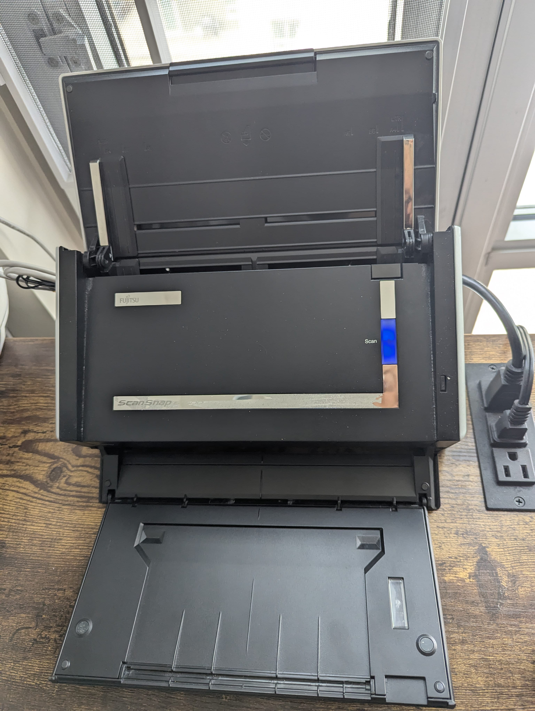

# scan-station

[](https://github.com/whizzzkid/scan-station/actions/workflows/release.yml)

Headless scanning server for Fujitsu ScanSnap and similar devices. Press the button, get a PDF delivered to your document management system.

## How It Works

1. Press the scan button on the scanner
2. `scanbd` detects the button press and calls `scan-station scan`
3. The document is scanned to PDF via [sane-scan-pdf](https://github.com/rocketraman/sane-scan-pdf)
4. The PDF is uploaded to all configured backends in parallel (filesystem, Papra, Paperless-NGX, S3, Google Drive)

## Quick Start (Docker)

**No config file needed.** The image works out of the box — just mount a volume for your scans:

```yaml
# docker-compose.yaml
services:
  scanner:
    image: ghcr.io/whizzzkid/scan-station:latest
    container_name: scanner
    hostname: scanner
    restart: always
    privileged: true
    environment:
      - TZ=America/Edmonton
    volumes:
      - /ingest:/scans
      - /var/run/dbus:/var/run/dbus
```

```sh
docker compose up -d
```

Scanned PDFs land in `/ingest` on your host. That's it.

See the [example/](example/) folder for a complete setup with `docker-compose.yml`, `.env`, and `config.toml` ready to copy to your server.

## Configuration

scan-station has three configuration layers (each overrides the previous):

1. **Built-in defaults** — works with zero config (Fujitsu, 300 DPI, Color, saves to `/scans/`)
2. **Environment variables** — override scan settings via Docker env vars
3. **TOML config file** — mount at `/etc/scan-station/config.toml` for multi-backend setups

### Environment Variables (simplest)

Customize scan settings without any config file:

```yaml
environment:
  - TZ=America/Edmonton
  - SCAN_VENDOR=fujitsu        # default: fujitsu
  - SCAN_DPI=600               # default: 300
  - SCAN_MODE=Gray             # default: Color
  - SCAN_FILE_PREFIX=invoice   # default: scan
  - SCAN_OUTPUT_DIR=/scans     # default: /scans
```

| Env Var | Default | Description |
|---------|---------|-------------|
| `SCAN_VENDOR` | `fujitsu` | Scanner vendor for sane-scan-pdf |
| `SCAN_DPI` | `300` | Scan resolution |
| `SCAN_MODE` | `Color` | Color, Gray, or Lineart |
| `SCAN_FILE_PREFIX` | `scan` | Filename prefix |
| `SCAN_DATE_FORMAT` | `%Y-%m-%d-%H%M%S-%3f-%Z` | Chrono timestamp format |
| `SCAN_OUTPUT_DIR` | `/scans` | Filesystem backend output path |
| `SCAN_PROGRAM` | `/app/sane-scan-pdf/scan` | Path to scan engine |
| `SCAN_TMP_DIR` | `/tmp/scan-station` | Temp directory |

### TOML Config File (for multi-backend setups)

For advanced setups (uploading to Papra, S3, etc.), mount a TOML config file:

```yaml
volumes:
  - ./config.toml:/etc/scan-station/config.toml:ro
```

Secrets in the TOML use `${ENV_VAR}` syntax — resolved from Docker environment at runtime, so the config file is safe to commit.

```toml
[scan]
vendor = "fujitsu"
dpi = 300
mode = "Color"

[[backends]]
type = "filesystem"
path = "/scans"
```

Env vars (`SCAN_DPI`, etc.) still override values from the TOML file.

## Backends

Each `[[backends]]` section defines an upload target. You can have multiple backends — they all receive the scanned PDF in parallel. You can even have multiple instances of the same backend type.

Every backend supports optional retry configuration:

```toml
[backends.retry]
max_retries = 3          # default: 0 (no retries)
retry_delay_ms = 2000    # default: 1000
```

---

### Filesystem

Copies the PDF to a local directory. This is the default backend.

```toml
[[backends]]
type = "filesystem"
path = "/scans"
```

| Field | Required | Description |
|-------|----------|-------------|
| `path` | yes | Target directory |

---

### Papra

Uploads to [Papra](https://papra.app) document management via its REST API.

```toml
[[backends]]
type = "papra"
api_url = "https://papra.example.com"
api_key = "${PAPRA_API_KEY}"
organization_id = "org-12345"
ocr_language = "eng"

[backends.retry]
max_retries = 3
retry_delay_ms = 2000
```

| Field | Required | Description |
|-------|----------|-------------|
| `api_url` | yes | Papra instance URL |
| `api_key` | yes | API key (use `${ENV_VAR}` for secrets) |
| `organization_id` | yes | Organization to upload into |
| `ocr_language` | no | OCR language (e.g., `eng`, `deu`, `fra`) |

Docker Compose environment:

```yaml
environment:
  - PAPRA_API_KEY=your-api-key-here
```

---

### Paperless-NGX

Uploads to [Paperless-NGX](https://docs.paperless-ngx.com) for automatic OCR, tagging, and document management.

```toml
[[backends]]
type = "paperless"
api_url = "https://paperless.example.com"
token = "${PAPERLESS_TOKEN}"
title = "Scanned Document"
tags = ["scanned", "inbox"]

[backends.retry]
max_retries = 3
retry_delay_ms = 2000
```

| Field | Required | Description |
|-------|----------|-------------|
| `api_url` | yes | Paperless-NGX instance URL |
| `token` | yes | API auth token (use `${ENV_VAR}`) |
| `title` | no | Default document title |
| `correspondent` | no | Default correspondent |
| `document_type` | no | Default document type |
| `tags` | no | List of tags to apply |

Docker Compose environment:

```yaml
environment:
  - PAPERLESS_TOKEN=your-token-here
```

---

### S3 / MinIO

Uploads to any S3-compatible object storage (AWS S3, MinIO, Backblaze B2, etc.).

```toml
[[backends]]
type = "s3"
bucket = "my-scans"
region = "us-east-1"
prefix = "scans/2025/"
access_key_id = "${AWS_ACCESS_KEY_ID}"
secret_access_key = "${AWS_SECRET_ACCESS_KEY}"

[backends.retry]
max_retries = 3
retry_delay_ms = 5000
```

For **MinIO** or self-hosted S3, add the `endpoint` field:

```toml
[[backends]]
type = "s3"
bucket = "scans"
region = "us-east-1"
endpoint = "https://minio.local:9000"
access_key_id = "${MINIO_ACCESS_KEY}"
secret_access_key = "${MINIO_SECRET_KEY}"
```

| Field | Required | Description |
|-------|----------|-------------|
| `bucket` | yes | S3 bucket name |
| `region` | no | AWS region (default: `us-east-1`) |
| `endpoint` | no | Custom endpoint URL (for MinIO, etc.) |
| `prefix` | no | Object key prefix (e.g., `scans/`) |
| `access_key_id` | yes | AWS access key or MinIO user |
| `secret_access_key` | yes | AWS secret key or MinIO password |

Docker Compose environment:

```yaml
environment:
  - AWS_ACCESS_KEY_ID=AKIA...
  - AWS_SECRET_ACCESS_KEY=...
```

---

### Google Drive

Uploads to a Google Drive folder using a service account.

```toml
[[backends]]
type = "google_drive"
credentials_file = "/etc/scan-station/gcloud-sa.json"
folder_id = "1ABCdef_ghijklmnop"

[backends.retry]
max_retries = 3
retry_delay_ms = 5000
```

| Field | Required | Description |
|-------|----------|-------------|
| `credentials_file` | yes | Path to service account JSON key file |
| `folder_id` | yes | Google Drive folder ID to upload into |

**Setup:**

1. Create a service account in [Google Cloud Console](https://console.cloud.google.com/iam-admin/serviceaccounts)
2. Enable the Google Drive API
3. Download the JSON key file
4. Share the target Drive folder with the service account email
5. Mount the key file into Docker:

```yaml
volumes:
  - ./gcloud-sa.json:/etc/scan-station/gcloud-sa.json:ro
```

---

## Full Example: Multiple Backends

This config saves locally AND uploads to Papra and S3:

```toml
[scan]
vendor = "fujitsu"
dpi = 300
mode = "Color"
file_prefix = "scan"

# Save locally
[[backends]]
type = "filesystem"
path = "/scans"

# Upload to Papra
[[backends]]
type = "papra"
api_url = "https://papra.example.com"
api_key = "${PAPRA_API_KEY}"
organization_id = "org-12345"

[backends.retry]
max_retries = 3
retry_delay_ms = 2000

# Archive to S3
[[backends]]
type = "s3"
bucket = "document-archive"
region = "us-west-2"
prefix = "scans/"
access_key_id = "${AWS_ACCESS_KEY_ID}"
secret_access_key = "${AWS_SECRET_ACCESS_KEY}"

[backends.retry]
max_retries = 3
retry_delay_ms = 5000
```

```yaml
# docker-compose.yaml
services:
  scanner:
    image: ghcr.io/whizzzkid/scan-station:latest
    privileged: true
    environment:
      - TZ=America/Edmonton
      - PAPRA_API_KEY=${PAPRA_API_KEY}
      - AWS_ACCESS_KEY_ID=${AWS_ACCESS_KEY_ID}
      - AWS_SECRET_ACCESS_KEY=${AWS_SECRET_ACCESS_KEY}
    volumes:
      - /nfs/scans:/scans
      - ./config.toml:/etc/scan-station/config.toml:ro
      - /var/run/dbus:/var/run/dbus
```

## CLI Usage

The `scan-station` binary can also be used standalone (without Docker):

```sh
# Scan and upload
scan-station --config config.toml scan

# Scan with overrides
scan-station --config config.toml scan --dpi 600 --mode Gray

# Scan without uploading
scan-station --config config.toml scan --no-upload

# Upload an existing file
scan-station --config config.toml upload /path/to/document.pdf

# Validate config and test backend connectivity
scan-station --config config.toml validate
```

The `discover-scanner` binary detects USB scanners:

```sh
# Auto-detect Fujitsu scanner
discover-scanner

# Specify vendor
discover-scanner --vendor canon
```

## Building from Source

```sh
# Default (filesystem backend only, ~2MB)
cargo build --release -p scan-station

# All backends (~4-5MB)
cargo build --release -p scan-station --features all-backends

# Only the backends you need
cargo build --release -p scan-station --features "filesystem,papra,s3"

# Discovery binary (~1MB)
cargo build --release -p discover-scanner
```

## The Device

These are pretty cheap to find used. I got mine for CA$5 from a [local electronics recycler](https://retail.era.ca).

| | |
| --- | --- |
| [Wikipedia Entry](https://en.wikipedia.org/wiki/List_of_Fujitsu_image_scanners) | [](https://upload.wikimedia.org/wikipedia/commons/c/c7/Scansnap_S1500_001_%285460070526%29.jpg)|
| [Fujitsu ScanSnap S1500 Front](./assets/ScanSnap_S1500_Front.jpg) | [](./assets/ScanSnap_S1500_Front.jpg) |
| [Fujitsu ScanSnap S1500 Rear](./assets/ScanSnap_S1500_Rear.jpg) | [](./assets/ScanSnap_S1500_Rear.jpg) |

This is a duplex scanner (scans both sides at once) with a gravity-fed tray and a scan button on the device.

### Non-Fujitsu Scanners

Set the `vendor` field in `[scan]` or pass `--vendor` to `discover-scanner`:

```toml
[scan]
vendor = "canon"
```

## Architecture

See [docs/architecture.md](docs/architecture.md) for the full system design.

## Adding Backends

See [docs/adding-backends.md](docs/adding-backends.md) for how to contribute new backends.

## Acknowledgements

- [ep1cman/fujitsu-ix1300-scan-on-button](https://github.com/ep1cman/fujitsu-ix1300-scan-on-button) — inspiration for this project
- [rocketraman/sane-scan-pdf](https://github.com/rocketraman/sane-scan-pdf) — the scan engine

## License

MIT
